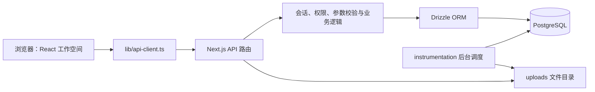
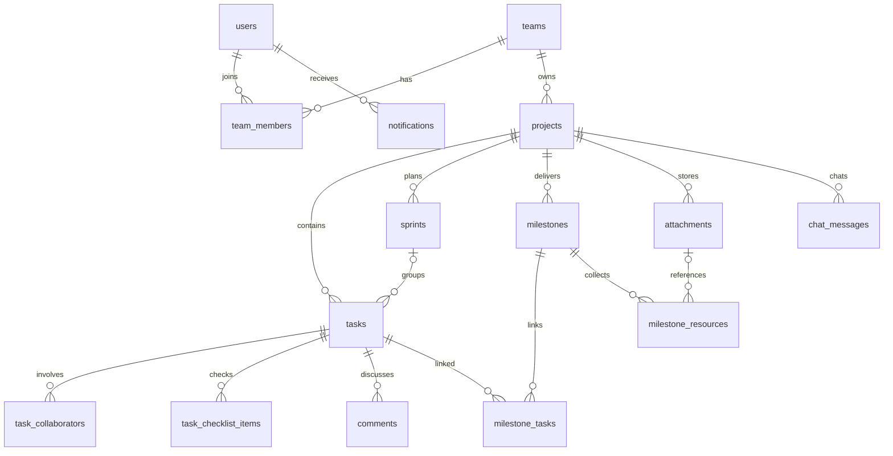

# 第一版技术全景与第二版接手指南

整理日期：2026-10-20。代码基线：`terry/workplace` 分支，提交 `e62a935`。

本文按产品阶段将当前代码称为“第一版”，覆盖此前多轮功能优化。此前发布批次不等同于本次产品第二版规划。本文基于本地代码核对，未连接生产服务器或实际数据库；表结构是 schema 定义，不能据此断言线上迁移已经完成。

## 1. 产品与技术架构

AgileCampus（敏捷校园）面向大学课程项目，已经形成“团队组建 → 项目建立 → 任务分工与协作 → 迭代推进 → 教学里程碑交付 → 汇报”的业务链路，辅以聊天、文件、日志与通知。

当前为一个 Next.js 全栈应用：页面与 API 在同一仓库、同一 Node.js 服务中运行，没有独立后端工程。

| 层次 | 当前实现 | 主要入口 |
| --- | --- | --- |
| 前端 | React 19.2.8、TypeScript、Tailwind CSS 4 与自定义 CSS | `app/`、`components/ws/` |
| 页面与后端 | Next.js 16.3.6 App Router、Route Handlers | `app/page.tsx`、`app/api/**/route.ts` |
| 请求与业务公共逻辑 | fetch 封装、Zod 校验、会话、权限、通知、文件维护 | `lib/` |
| 数据访问 | Drizzle ORM + postgres 驱动 | `db/index.ts` |
| 持久化 | PostgreSQL；附件实体保存于本地 `uploads/` | `db/schema.ts`、`uploads/` |
| 后台工作 | Node.js 启动后运行截止提醒与文件清理 | `instrumentation.ts` |



## 2. 第一版已实现模块

| 模块 | 已实现能力 | 关键代码入口 |
| --- | --- | --- |
| 账号与个人资料 | 邮箱注册登录、唯一学工号、资料修改、退出、会话、在线状态 | `app/login/page.tsx`、`app/settings/page.tsx`、`lib/auth.ts`、`lib/presence.ts` |
| 团队与成员 | 团队创建与管理、邀请与申请审批、成员角色、多分工标签 | `TeamPanel.tsx`、`TeamInvitations.tsx`、`lib/team-invites.ts`、`lib/team-duties.ts` |
| 项目空间 | 团队下建项目、课程字段、收藏、归档、成员与项目统计 | `ProjectSidebar.tsx`、`SpacePanel.tsx`、`Modals.tsx`、`app/api/projects/` |
| 任务管理 | 项目内编号、状态与优先级、截止日、负责人、多人协作、标签、子任务、检查清单、评论、附件 | `TaskPanel.tsx`、`TaskParticipants.tsx`、`TaskChecklist.tsx`、`CollaboratorPicker.tsx` |
| 任务视图与待办 | 列表与三列看板、搜索筛选、个人待办、详情抽屉 | `TaskBoard.tsx`、`TaskFilterBar.tsx`、`lib/task-filters.ts` |
| Sprint 迭代 | 创建、启动、完成、任务归属与活跃迭代管理 | `SpacePanel.tsx`、`lib/sprint-permissions.ts`、`app/api/sprints/` |
| 教学周里程碑 | 学期开始日、教学周与星期换算、交付要求、关联任务、完成状态 | `MilestonePanel.tsx`、`lib/milestones.ts` |
| 里程碑成果 | 上传成果、关联已有文件、外部链接、移除关联 | `MilestoneResources.tsx`、里程碑 `resources` API |
| 项目聊天 | 频道消息、回复、关联任务、赞同、公告置顶、@提及 | `ChatPanel.tsx`、项目 `chat` API、`app/api/chat/` |
| 文件库 | 项目与任务附件、上传下载撤回、文件列表同步、物理文件清理 | 项目 `files` API、`app/api/files/`、`lib/file-cleanup.ts` |
| 汇报摘要 | 本周/上周/本月或自选区间、完成与当前进度汇总、补充阻碍和计划、文本输出 | `ReportPanel.tsx`、`lib/report-summary.ts`、项目 `report` API |
| 日志与通知 | 项目操作日志、分配/评论/提及通知、截止提醒、已读与清理、点击跳转 | `ProjectActivitySidebar.tsx`、`NotificationEntry.tsx`、`lib/activity.ts`、`lib/notify.ts` |
| 交互与可靠性 | 主题、分资源加载与错误重试、取消过期请求、防重复提交、轮询协调 | `ThemeProvider.tsx`、`lib/request-gate.ts`、`lib/task-action.ts`、`lib/polling.ts` |

表中未标目录的组件均位于 `components/ws/`。这些是当前实现清单，并非逐项线上验收记录。

## 3. 项目结构与代码分工

```text
app/
  page.tsx                 工作空间入口、状态与数据加载、操作编排
  layout.tsx               应用根布局
  login/page.tsx           登录与注册界面
  settings/page.tsx        个人设置
  api/                     后端接口，按业务资源分目录
  globals.css              全局样式
  workspace-theme.css      工作空间主题样式
components/ws/             业务面板、侧栏、任务详情、弹窗、共享组件
  shared.tsx               WorkspaceContext、共享类型与 UI 基础组件
lib/
  api-client.ts            前端请求封装、前后端交互类型、格式化工具
  api.ts                   后端鉴权、访问权限、参数解析、统一错误响应
  auth.ts                  密码哈希与数据库会话
  request-security.ts      请求来源与 Cookie 安全规则
  rate-limit.ts            数据库登录限流
  task-*.ts                任务筛选、协作、检查清单与操作协调
  notify.ts / activity.ts  通知与活动记录
  deadline-reminders.ts    截止提醒生成与去重
  file-cleanup.ts          文件路径与清理队列消费
db/
  index.ts                 数据库连接
  schema.ts                27 张表的结构定义
  add-*.ts                 增量数据库升级脚本
  fix-chat-timezone.ts     聊天时间字段修复脚本
  seed.ts                  演示数据初始化
tests/                     业务规则、权限、事务和前端状态逻辑测试
docs/                      API、部署、迁移、专项维护文档
public/                    静态资源
uploads/                   运行时附件，独立持久化
proxy.ts                   /api 请求来源校验入口
instrumentation.ts         服务启动钩子与后台维护调度
drizzle.config.ts          Drizzle 工具配置
docker-compose.yml         本地开发数据库配置
```

前端主要依赖 React 状态与 Context。`app/page.tsx` 是状态与操作的集中入口；各业务面板消费共享工作空间。后端路由直接组合权限检查、业务逻辑和 Drizzle 查询，部分复用逻辑已抽到 `lib/`，尚未形成统一的 service/repository 分层。

### 一次典型任务操作如何流转

1. 用户在任务面板或抽屉提交修改。
2. 前端经 `lib/api-client.ts` 请求 `/api/tasks/[id]`。
3. `proxy.ts` 执行请求来源校验；路由校验用户、项目访问权限与输入。
4. 路由结合事务更新任务及相关数据，按操作生成活动和通知。
5. 返回后刷新相关资源；刷新失败时提示重试，避免误认为保存失败而重复提交。

`RequestGate` 负责取消或忽略过期请求，避免切换项目后旧响应覆盖新项目。`TaskAction` 在提交开始时同步加锁，并区分写入失败和写入成功后的刷新失败。

## 4. API 地图

当前共有 **34 个 `route.ts` 路由文件**；下表按真实导出方法整理，不等同于 34 个 HTTP 操作。动态路径中的 `id` 随资源代表团队、项目、任务等 ID。

| 资源 | 路径 | 方法 |
| --- | --- | --- |
| 登录、注册、退出 | `/api/auth/login`、`/api/auth/register`、`/api/auth/logout` | 各 POST |
| 当前用户 | `/api/auth/me` | GET、PUT |
| 团队集合 / 单团队 | `/api/teams` / `/api/teams/[id]` | GET、POST / GET、PUT、DELETE |
| 邀请入口 / 邀请管理 | `/api/teams/join` / `/api/teams/[id]/invite` | GET、POST / GET、POST、DELETE |
| 入队申请 | `/api/teams/[id]/join-requests` | GET、PUT |
| 加成员 / 成员管理 | `/api/teams/[id]/members` / 其下 `[userId]` | POST / PUT、DELETE |
| 成员分工 | `/api/teams/[id]/members/[userId]/duty` | PUT |
| 团队标签 / 单标签 | `/api/teams/[id]/labels` / `/api/labels/[id]` | GET、POST / PUT、DELETE |
| 项目集合 / 单项目 | `/api/projects` / `/api/projects/[id]` | GET、POST / GET、PUT、DELETE |
| 收藏项目 | `/api/projects/[id]/star` | POST |
| 项目迭代 / 单迭代 | `/api/projects/[id]/sprints` / `/api/sprints/[id]` | GET、POST / PUT |
| 任务集合 / 单任务 | `/api/tasks` / `/api/tasks/[id]` | GET、POST / GET、PUT、DELETE |
| 任务评论 | `/api/tasks/[id]/comments` | GET、POST |
| 任务检查清单 | `/api/tasks/[id]/checklist` | GET、POST、PUT、DELETE |
| 里程碑 | `/api/projects/[id]/milestones` | GET、POST、PUT、DELETE |
| 里程碑成果 | `/api/projects/[id]/milestones/[milestoneId]/resources` | GET、POST、DELETE |
| 项目聊天 | `/api/projects/[id]/chat` | GET、POST |
| 赞同 / 公告置顶 | `/api/chat/[id]/like` / `/api/chat/[id]/pin` | POST / PUT |
| 文件集合 / 单文件 | `/api/projects/[id]/files` / `/api/files/[id]` | GET、POST / GET、DELETE |
| 项目日志 | `/api/projects/[id]/activities` | GET |
| 汇报摘要 | `/api/projects/[id]/report` | GET |
| 通知 | `/api/notifications` | GET、PUT、DELETE |
| 总览统计 | `/api/overview` | GET |

通用约定：会话使用 Cookie；JSON 输入通常经 Zod 校验；上传使用 multipart；文件下载返回文件响应。业务异常由 `lib/api.ts` 统一处理，例如未登录 401、无权限 403、资源不存在 404、冲突 409。具体请求体与筛选参数应继续查看对应路由内的 schema。

权限以团队成员身份与团队角色 `owner/admin/member` 为核心。`users.role` 为平台角色预留，不能直接当作团队权限。项目访问检查实际依据项目所属团队的成员关系，`project_members` 的存在不代表已经实现“仅项目成员可见”的隔离模型。课程分工标签与系统角色分别保存，但创建迭代等部分操作还使用 `canManageDuties` 判断，调整权限前需一起核对。

## 5. 数据库地图

`db/schema.ts` 当前定义 **27 张表**，按业务归类如下：

| 领域 | 表 | 作用 |
| --- | --- | --- |
| 用户与安全（3） | `users`、`sessions`、`auth_rate_limits` | 账号资料、会话、登录限流 |
| 团队（4） | `teams`、`team_members`、`team_invites`、`team_join_requests` | 团队、角色与分工、邀请码、审批 |
| 项目（3） | `projects`、`project_members`、`project_stars` | 项目、成员关联、个人收藏 |
| 计划与交付（4） | `sprints`、`milestones`、`milestone_tasks`、`milestone_resources` | 迭代、教学里程碑、任务关联、成果关联 |
| 任务（6） | `tasks`、`labels`、`task_labels`、`task_collaborators`、`task_checklist_items`、`comments` | 任务主体、团队标签、多标签、参与者、步骤、讨论 |
| 聊天（2） | `chat_messages`、`chat_likes` | 消息、回复与关联任务、赞同 |
| 日志与提醒（3） | `activities`、`notifications`、`task_deadline_reminders` | 变更日志、个人通知、提醒去重 |
| 附件维护（2） | `attachments`、`file_cleanup` | 文件元数据、物理文件清理队列 |



以上是核心关系简图，省略部分外键和辅助表。理解数据时重点注意：

- 团队与项目是一对多；标签属于团队，任务属于项目。
- 任务编号由项目 key 与项目内 number 拼成，例如 `WEB-024`，并有项目内唯一约束。
- `tasks.parent_task_id` 自引用形成独立子任务；检查清单是另一张轻量步骤表，两者语义不同。
- 任务与标签、协作成员、里程碑通过关联表建立关系；负责人另保存在任务主体中。
- 任务状态为 `todo/doing/done`；迭代为 `planned/active/completed`；项目为 `active/archived`。
- 成果记录必须在文件引用与外部链接中二选一，有数据库 check 约束。移除成果关联不等于撤回原文件；附件撤回会级联移除成果引用。
- 文件内容不入库。删除附件记录与删除磁盘文件分开处理，清理队列支持重试；数据库触发器在文件清理升级脚本中维护。
- 部分外键级联删除，部分置空；删除团队、项目、任务前应阅读 schema 与相应事务逻辑。
- 日期与时间类型并未全部统一：任务截止日等使用 date，聊天时间已声明带时区，其他部分字段仍是无时区 timestamp。旧聊天数据转换需先确认历史语义。

## 6. 第一版可靠性与运行机制

| 方面 | 当前机制与边界 |
| --- | --- |
| 登录 | scrypt 加盐哈希；随机会话令牌保存于数据库与 HttpOnly Cookie；会话有效期 7 天 |
| 请求保护 | API 来源校验、生产 Cookie 安全配置、数据库限流 |
| 并发写入 | 核心任务、成员、成果等操作有事务与约束配合；不是所有业务都已抽象为统一事务服务 |
| 数据同步 | 聊天与活动约 8 秒轮询；通知、总览、个人任务、项目详情与文件约 20 秒轮询；以各调用点为准 |
| 截止提醒 | 服务启动及每分钟检查，通知读取也可触发；按 UTC+8 日期判断，任务/收件人/截止日唯一去重 |
| 文件维护 | 启动及每分钟清理队列；单文件上限 100MB，反向代理限制需匹配 |
| 汇报口径 | 期间完成来自完成日志与创建记录；进行中、逾期与里程碑为生成时状态，并非完整历史快照 |
| 通知定位 | 可打开任务或项目聊天；聊天通知未存具体消息 ID，不能直接定位某条消息 |

聊天当前没有 WebSocket 推送。文件保存于应用服务器，尚未接对象存储。后台提醒和清理依赖常驻 Node.js 进程，未来调整部署形态时要迁移这两项职责。

## 7. 数据库升级、部署与验证入口

数据库有三类操作，协作时需要区分：`db/schema.ts` 描述目标结构；`db/add-*.ts` 和时间修复脚本升级已有数据库；`db/seed.ts` 初始化演示数据。已有业务库不应通过重复 seed 更新，`db:push` 也不能替代文件清理触发器等升级步骤。

增量脚本覆盖成员单/多分工、课程、里程碑、邀请码、认证保护、文件清理、任务协作、检查清单、截止提醒和里程碑成果。具体执行顺序、前置检查及聊天时区转换见发布与部署文档。

已有交接记录的生产架构为 Nginx HTTPS → 常驻 Next.js 服务 → PostgreSQL，systemd 管理进程；Docker 用于本地开发数据库。生产实时状态与提交号需要另行核对。代码、数据库、环境配置和 uploads 是分别维护的交付内容，Git 更新不会自动完成其他三项更新。

测试分布于 `tests/` 与部分 `lib/*.test.mjs`，涉及权限、事务回滚、成员与任务协作、文件一致性、成果、筛选、教学周、时间、轮询、请求安全和通知跳转。部分测试连接数据库，应先检查测试代码及目标环境。当前 `package.json` 没有统一 `test` 脚本；类型检查、lint、build 和有选择的测试是现有验证入口。本文仅完成静态梳理，未重新运行测试、构建或数据库迁移。

现有文档入口：

- [README](../README.md)：启动与维护导航。
- [部署指南](deployment.md)、[实际服务器交接](server-handoff.md)：持续维护的升级要求、实际配置、备份与恢复步骤。
- [登录保护](login-protection.md)、[附件一致性](file-cleanup.md)、[通知与提醒](notifications.md)、[聊天时区](chat-timezone.md)：专项机制。

## 8. 第二版协作建议

| 工作方向 | 建议先读 | 修改时联动检查 |
| --- | --- | --- |
| 页面与交互 | `app/page.tsx` → `shared.tsx` → 对应面板 | API 类型、加载与重试、切换项目、主题样式 |
| 任务功能 | `TaskPanel.tsx` → 任务 API → `tasks` 相关表 | 协作成员、待办、日志、通知、检查清单与事务 |
| 团队与权限 | `lib/api.ts` → `team-duties.ts` → 团队 API | 角色与分工差别、项目访问、移除成员后的关联数据 |
| 课程交付 | 里程碑/成果面板 → 对应 API → schema | 日期换算、关联任务、文件保留与撤回 |
| 数据与部署 | schema → 增量脚本 → 发布文档 | 兼容已有数据、约束与触发器、备份与迁移验证 |

建议第二版优先明确四项工程边界：拆分集中在 `app/page.tsx` 的状态与操作；逐步从较大的路由中抽取业务服务；明确团队与项目的权限模型；统一数据库迁移记录和测试入口。它们是基于当前结构提出的后续建议，尚未作为本次变更实施。

新增功能时，按“界面 → 请求与类型 → 路由校验 → 业务与权限 → 表结构与迁移 → 日志通知 → 测试与发布说明”检查影响范围，便于多人协作时明确负责人与接口边界。
